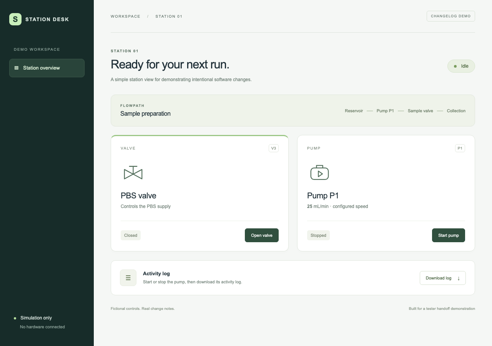

# Station Desk · tester handoff demo

A small fictional station app showing how reviewed PR change notes become
**build handoffs** and **release notes** for testers. No Deimos/Hyperion code,
company data, hardware connection or external station service is used.

## Start here

- [Meeting walkthrough](docs/DEMO.md)
- [Releases and final tester handoffs](https://github.com/michaelbourlotos/tester-handoff-demo/releases)
- [Test builds and their handoffs](https://github.com/michaelbourlotos/tester-handoff-demo/actions/workflows/checks-and-build.yml)
- [Example PRs](https://github.com/michaelbourlotos/tester-handoff-demo/pulls?q=is%3Apr)
- [Agent instructions](AGENTS.md) · [Change-note template](docs/change-note-template.yaml)

Prepared examples: [visual PR #1](https://github.com/michaelbourlotos/tester-handoff-demo/pull/1),
[log change PR #2](https://github.com/michaelbourlotos/tester-handoff-demo/pull/2),
and [missing-note PR #3](https://github.com/michaelbourlotos/tester-handoff-demo/pull/3).



## The process

1. The coding agent maintains one new change-note YAML file per PR, in plain
   language: what changed, why, previous/expected behavior and what to test.
2. For visual changes, the agent captures the actual app before and after using
   the same view and state. The developer reviews the note and evidence.
3. GitHub checks that the PR adds its own complete note and required images.
   It cannot prove the note is accurate, exhaustive or easy to understand.
4. A successful PR/main build includes the app, `TESTER-HANDOFF.md`, its images,
   and `build.json` recording the exact code and comparison baseline. The Actions
   summary also displays the handoff. Build downloads expire after 30 days.
5. A manually requested release uses Changie to format notes between the chosen
   previous release and exact build commit/tag. It creates a draft GitHub Release
   with images and a permanent downloadable app/handoff package. A lead reviews
   and publishes it. Publishing a manually created release can also populate its
   notes; include `<!-- previous-release: v0.1.0 -->` in its body first.

Release and build aggregation never reads whatever happens to be newest on main.
The source notes stay in `.changes/unreleased/` as an immutable per-PR record;
the range selector stages only the relevant fragments for Changie. There is no
shared rolling file for every developer to edit and no Python requirement.

## Try the app locally

Install Node 22 or later, then:

```sh
npm ci
npm start
```

Open http://127.0.0.1:4178. Every control is simulated. Start and stop the pump,
then use **Download log** to inspect the nonvisual example.

## Author a visual note

```sh
npx playwright install chromium
# Commit the screen change, then capture exact committed app sources:
npm run screenshots -- --base <PR-merge-base> --head HEAD --change <note-id>
```

Copy the template to `.changes/unreleased/<note-id>.yaml`, reference the captured
files, and commit the note and PNGs. If app source changes, recapture. The capture
manifest records both commits and source/image hashes; the check rejects stale
sources or changed images. This is traceability, not proof of correctness.

## Build and release handoffs

```sh
npm run changie:install
# Handoff for a test build, compared with the last release:
node scripts/build.mjs --baseline v0.1.0 --target HEAD --number local
# Compare with an earlier tested build by supplying its full code SHA instead:
node scripts/build.mjs --baseline <earlier-build-sha> --target HEAD --number local
# Local release preview (does not publish):
npm run release:preview -- --tag v0.2.0 --previous v0.1.0 --target HEAD
```

The Actions **Run workflow** button also accepts an earlier build SHA/tag as the
baseline. Baselines must be ancestors of the target; unrelated PR branches need
a deliberate common baseline. PR builds are previews, not releases or approvals.

## Merge enforcement and limits

Make **Required tester change note** a required branch-protection check and apply
it to administrators. Private personal repositories need GitHub Pro for this.
If the account lacks that feature, the demo still shows failing/passing checks
and withholds the downloadable tester build, but GitHub does not block merging.

**Current demo account:** GitHub returned “Upgrade to GitHub Pro” when required
branch protection was requested. This repository remains private; merge-button
blocking is not enabled. The red-check and withheld-build examples are real.

The GUI-path rule covers this demo's known screen sources; a real project must
configure its own paths and capture routine. Agent instructions also require
screenshots for visual changes elsewhere. Notes may describe overlapping or
reverted changes: a lead must reconcile them before releasing. No AI service is
called in CI; an agent drafts the committed notes during development.

Changie 1.26.0 and its installer checksums, dependencies and workflow actions are
pinned. Only the trusted release job has permission to publish to this demo repo.
